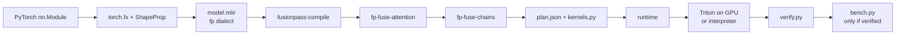

<div align="center">

# fusionpass

### Fuse attention. Kill the S×S write. Keep the math honest.

**An MLIR compiler pass that turns a PyTorch graph into tiled Triton kernels — and refuses to quote a speedup until it matches eager PyTorch.**

[](https://llvm.org)
[](https://pytorch.org)
[](https://triton-lang.org)
[](https://developer.nvidia.com/cuda-toolkit)
[](https://www.python.org)
[](#limitations)

```text
  Q, K, V  ──►  matmul → scale → softmax → matmul     6 global-memory round trips
                         ║ fuse
                         ▼
  Q, K, V  ──►  █ fp_attention █                       one kernel · O(S·D) tiles
```

</div>

---

## What it is

A PyTorch `nn.Module` (static shapes, f16/f32, inference only) is traced with `torch.fx` into textual MLIR in a small custom dialect called **`fp`**. A C++ tool, `fusionpass-compile`, parses that MLIR, runs fusion passes, and emits `plan.json` (an ordered list of steps) and `kernels.py` (generated Triton source). A Python runtime executes the plan: fused regions run as Triton kernels, everything else as plain PyTorch ops.

A verification harness proves numerical equivalence against eager PyTorch **before any speedup is reported**. A fusion that changes results is a miscompilation, not an optimization.

Target users are ML-systems engineers and students who want a working, readable example of an MLIR fusion pass with real GPU codegen. Unfused ops write each result to GPU global memory and the next op reads it back; fusing removes those round trips. For attention, fusion also avoids ever materializing the **S×S score matrix**.

<table>
<tr>
<td width="33%" align="center">

**Trace**
`torch.fx` + ShapeProp
→ `func.func @main`

</td>
<td width="33%" align="center">

**Fuse**
`fp-fuse-attention`
then `fp-fuse-chains`

</td>
<td width="33%" align="center">

**Prove, then time**
match eager first
speedup second

</td>
</tr>
</table>

---

## Quick start

Linux is the supported build (CI, or a Linux Docker container). Native Windows C++ is out of scope.

### 1. LLVM/MLIR 18.1.8 (once)

Skip if `$LLVM_PREFIX` already has `bin/FileCheck` and `bin/mlir-opt`.

```bash
git clone --depth 1 --branch llvmorg-18.1.8 https://github.com/llvm/llvm-project.git
cmake -S llvm-project/llvm -B llvm-project/build -G Ninja \
  -DLLVM_ENABLE_PROJECTS=mlir -DLLVM_TARGETS_TO_BUILD=host \
  -DCMAKE_BUILD_TYPE=Release -DLLVM_ENABLE_ASSERTIONS=ON \
  -DLLVM_INSTALL_UTILS=ON -DLLVM_BUILD_EXAMPLES=OFF \
  -DCMAKE_INSTALL_PREFIX="$LLVM_PREFIX"
cmake --build llvm-project/build --target install
```

### 2. Package, build, demo

```bash
python -m venv .venv && source .venv/bin/activate
export LLVM_PREFIX="${LLVM_PREFIX:-$HOME/llvm-install}"
export FUSIONPASS_BUILD_DIR=build
pip install -e ".[dev]"
bash scripts/build.sh
export FUSIONPASS_COMPILE="$PWD/build/bin/fusionpass-compile"

python -m fusionpass check
python -m fusionpass demo attention
python -m fusionpass demo chain
```

The `fusionpass` console script is the same entry point.

- **GPU:** install a CUDA PyTorch wheel from [pytorch.org](https://download.pytorch.org/whl/). That wheel **bundles Triton** — do not `pip install triton` separately.
- **CPU / CI:** the CPU torch wheel does not bundle Triton. Set `TRITON_INTERPRET=1` *before* importing Triton (`tests/conftest.py` does this). CI pins a CPU-interpreter Triton; GPU machines should use the wheel’s copy.

On CPU, demos verify and print `benchmark : skipped (no CUDA; interpreter mode is correctness-only)`. On CUDA they also print timing and estimated traffic.

<details>
<summary><strong>This checkout (Windows 11 + Docker Linux + RTX 4090)</strong></summary>

| | |
|---|---|
| LLVM/MLIR | **18.1.8**, built in Docker Linux — do not rebuild |
| `LLVM_PREFIX` | `C:\Users\018224960\llvm-install` (bind-mount into the container) |
| GPU | GeForce **RTX 4090**, driver **610.60**, CUDA **13.3** |
| Host `.venv` | Python 3.12, **CPU** `torch 2.15.0+cpu` — no Triton, `cuda` is false |
| C++ tools | Linux ELF in `build/bin/`; Windows pytest docker-execs them |

Run `scripts/build.sh` and the demos **inside Linux**, not PowerShell.

</details>

---

## How it works



```
 PyTorch nn.Module
      │  torch.fx symbolic_trace + ShapeProp          python/fusionpass/frontend.py
      ▼
 model.mlir   (func.func @main + fp dialect ops)
      │  fusionpass-compile   (C++ / MLIR)
      │     parse → verify → fp-fuse-attention → fp-fuse-chains → emit plan + Triton src
      ▼
 plan.json  +  kernels.py (Triton source)
      │  python/fusionpass/runtime.py  (+ validate_plan)
      ▼
 PyTorch ops (unfused)  |  Triton kernels (fused)  → CUDA GPU (or Triton interpreter on CPU)
      │
 verify.py  (equivalence gate)  ──►  bench.py (speedup, only if verified)  + traffic.py
      │
 python -m fusionpass demo | check
```

- **Trace.** `torch.fx` plus `ShapeProp` produce static shapes; `frontend.py` emits textual `fp` MLIR with entry `func.func @main`.
- **Fuse.** `fusionpass-compile --pipeline fuse` verifies the module, then runs `--fp-fuse-attention` **before** `--fp-fuse-chains` so attention’s scale/softmax are not swallowed by a generic chain.
- **Emit.** Writes `plan.json` (v1: `torch` and `triton` steps), `kernels.py`, and `optimized.mlir`. Kernel names: `fp_chain_<N>` and one shared `fp_attention`.
- **Run.** Fused regions launch as `flat` / `rows` / `attention`. Everything else stays PyTorch. `validate_plan` rejects a corrupt plan before any kernel runs.
- **Gate.** `verify.py` compares against eager PyTorch. `bench.py` **refuses to report a speedup** unless `compiled.verified is True`.

Env: `LLVM_PREFIX`, `FUSIONPASS_BUILD_DIR` (default `build`), `FUSIONPASS_COMPILE`.

---

## Supported subset

| | Allowed |
|---|---|
| Ops | `add` `mul` `scale` `relu` `exp` `softmax` `matmul` `transpose` → fused `fused_chain` / `fused_attention` |
| Dtypes | **f16**, **f32** |
| Shapes | Static ranked tensors · **one** graph output |
| Device | Single device · CUDA for kernels/benches · CPU via `TRITON_INTERPRET=1` |
| Attention | Self-attention · `D ∈ {16, 32, 64, 128}` · **no masks** |
| Chains | Elementwise + at most one last-axis softmax · last dim ≤ 8192 |

No broadcasting (elementwise operands must match). `fuse` defaults to **`False`**. `compile_model(..., verify=True, strict=True)` is the default gate. Write models functionally — `call_module` leaves are rejected.

---

## Results

**Not yet measured.** No timings are copied here because they were not recorded from `python -m fusionpass demo ...` on this hardware. Intended GPU: **NVIDIA GeForce RTX 4090**.

Populate this table **only** with printed demo lines. State GPU model, PyTorch, and Triton versions. Speedup is versus *unfused eager PyTorch* in the same dtype — **not** versus `scaled_dot_product_attention`.

| model | shape | dtype | eager ms | fused ms | speedup | verified |
|---|---|---|---|---|---|---|
| attention | B=4, H=8, S=1024, D=64 | f16 | — | — | — | not yet measured |
| chain | rows=8192, cols=1024 | f16 | — | — | — | not yet measured |

```bash
python -m fusionpass demo attention --dtype f16 --batch 4 --heads 8 --seq 1024 --head-dim 64
python -m fusionpass demo chain --dtype f16 --rows 8192 --cols 1024
```

Demo traffic numbers are a **rough estimate** (no caches, no PyTorch internal fusion, no L2 reuse).

---

## Verification policy

> **No speedup without equivalence.** `benchmark()` raises `UnverifiedSpeedupError` if `compiled.verified` is not true — checked *before* the CUDA requirement.

`default_tolerances(dtype, has_attention)`:

| dtype | fused attention? | atol / rtol | why |
|---|---|---|---|
| f16 | any | `1e-2` / `1e-2` | eager rounds every op to fp16; kernels accumulate in fp32 |
| f32 | yes | `5e-3` / `5e-3` | GPU `tl.dot` / TF32 vs IEEE |
| f32 | no | `1e-4` / `1e-4` | reordering / fused rounding only |

Compare against eager in the **same dtype**. NaN/Inf patterns must match. Trials use a fixed CPU seed, then move to the device.

| CLI | exit |
|---|---|
| `python -m fusionpass check` | `0` ok · `3` compiler missing |
| `python -m fusionpass demo attention\|chain` | `0` ok · `2` verify failed · `3` compiler missing |

---

## Limitations

Not in this project:

- Native **Windows** C++ (this tree is edited on Windows 11; LLVM builds run in Linux Docker / CI)
- Causal or arbitrary masks · cross-attention fusion (mismatched Q/K/V stay unfused)
- Broadcasting · dynamic shapes · multiple graph outputs
- Autograd / bf16 / autotuning (`BLOCK_M=64`, `BLOCK_N=64`, `num_warps=4`, `num_stages=2`)
- Racing `scaled_dot_product_attention`

Also: per-shape recompilation; row-softmax keeps the whole row in registers (cap 8192); Python launch overhead on unfused steps.

Deeper internals: [`docs/design.md`](docs/design.md).

---

## Testing

```bash
export LLVM_PREFIX=...
export FUSIONPASS_BUILD_DIR=build
export FUSIONPASS_COMPILE="$PWD/build/bin/fusionpass-compile"
bash scripts/build.sh          # cmake + ninja, then lit -v test/ and pytest -q
```

- **lit** (`test/`): roundtrip, invalid, invalid_fused, fuse_attention, fuse_chains (incl. operand dedupe). Needs `FileCheck` from `$LLVM_PREFIX/bin`.
- **pytest** (`tests/`): frontend, e2e, fusion e2e, plan validation, verify/bench gate, edge cases. CPU uses the Triton interpreter; the fp16 GPU test skips without CUDA. CI does not assert timings.

CI (`.github/workflows/ci.yml`) is CPU-only: Ubuntu 22.04, cached LLVM 18.1.8, CPU `torch==2.15.0`, and `triton~=3.9.0` because the CPU wheel does not ship Triton. On a GPU box, use the Triton that comes with the CUDA wheel.

---

<div align="center">

**Trace → fuse → generate → prove → (then) time.**

`python -m fusionpass demo attention`

</div>
